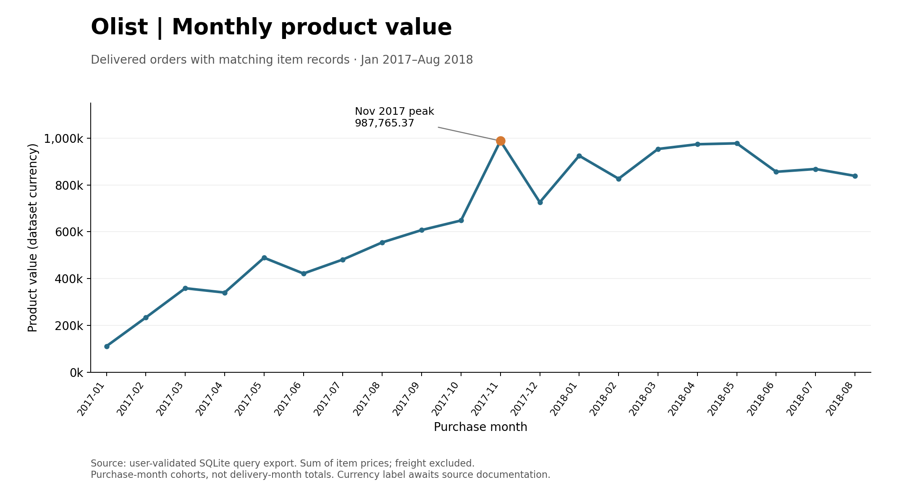
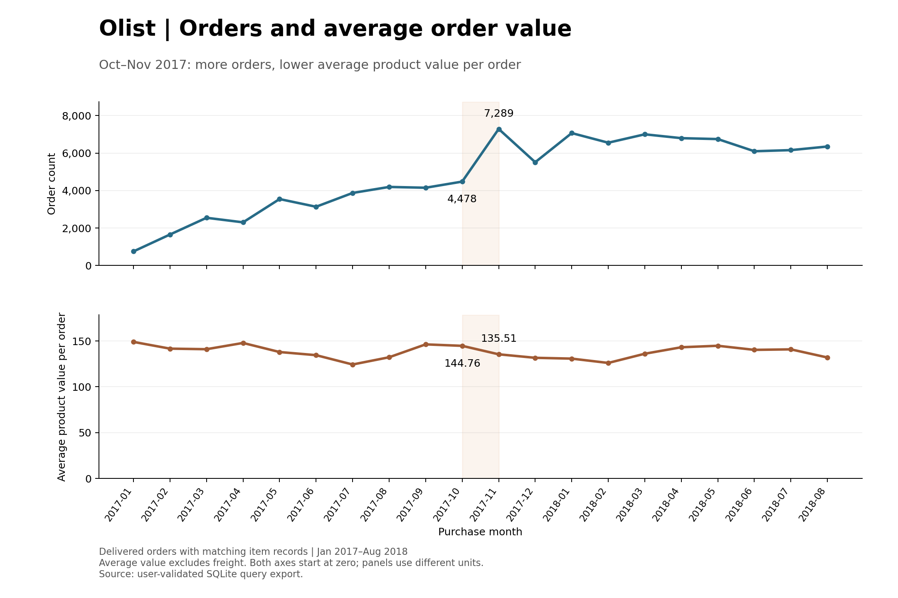
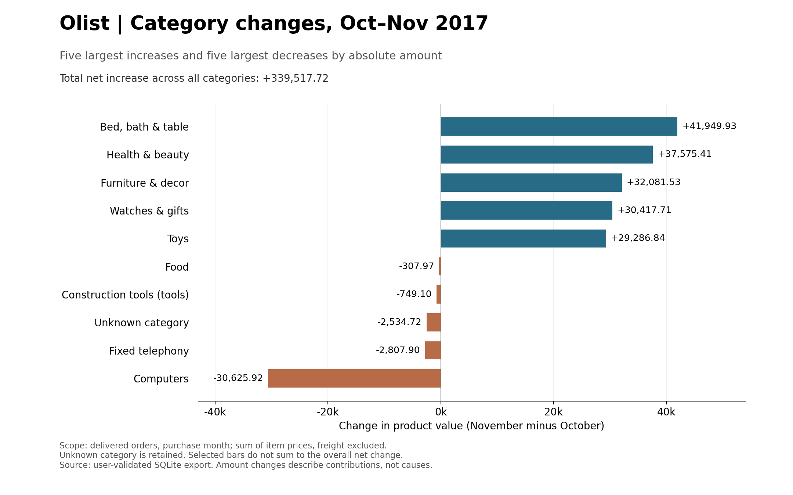
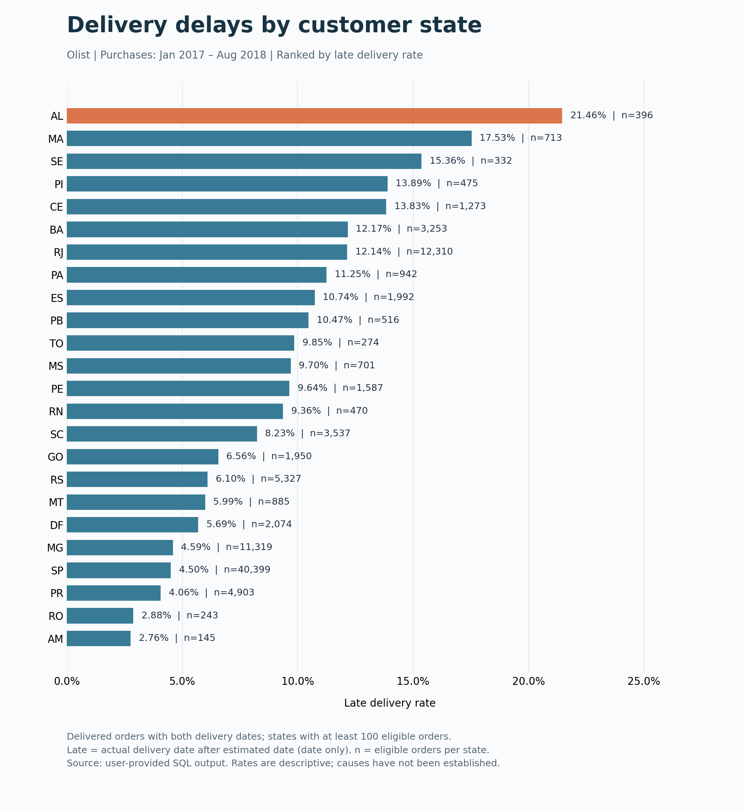

# Olist Order and Delivery Analysis

## Objective
Use SQL to examine monthly order and product value trends, category contributions to growth, and delivery delays by customer state.

## Tools
- SQLite
- DataGrip

## Analysis Scope
- Purchase period: January 2017–August 2018
- Order status: delivered
- Product value: sum of item prices, excluding freight
- Category comparison: October versus November 2017
- Late delivery: actual delivery date is after the estimated delivery date

## Key Findings

### 1. Monthly Orders and Product Value
From October to November 2017, order counts increased from 4,478 to 7,289.
Average product value per order decreased from 144.76 to 135.51, while total product value increased from 648,247.65 to 987,765.37.
The increase in order volume more than offset the decrease in average product value per order.

### 2. Category Contributions to Growth
In November 2017, watches_gifts had the highest total product value at 95,292.34.
However, bed_bath_table recorded the largest increase from October: 41,949.93, representing approximately 12.36% of the total net increase of 339,517.72.

The category with the highest November sales value was therefore different from the category contributing the largest amount to month-over-month growth.
Changes in unit prices and quantities sold were not analyzed separately, so the causes of growth cannot be established.

### 3. Delivery Delays by State
Among the 24 states with at least 100 eligible orders, AL had the highest late delivery rate at 21.46%: 85 late orders out of 396.

AL was selected for further investigation because of its high proportion of delayed orders.
A follow-up analysis should examine whether delays were concentrated in particular months.

If the objective is to reduce the total number of late orders, SP (1,817 late orders) and RJ (1,495) should also be considered.
This analysis does not establish the causes of differences between states.

## Data Quality and Validation
- Duplicate checks found no duplicate groups for order IDs, customer IDs, product IDs, or category translation keys.
- There were no unmatched records in the orders-to-customers or order_items-to-products joins.
- Monthly KPIs for all 20 months matched an alternative approach that aggregates item prices per order first.
- The sum of category changes matched the difference in monthly product value totals.
- The main delivery delay query and its CTE version returned identical results for all 24 states.

### Missing Data Handling
- In October–November 2017, 186 order-item rows lacked an English category, with a total product value of 30,107.82. These rows were retained as unknown.
- Of 96,211 delivered orders within the purchase period, 8 (approximately 0.0083%) had missing delivery dates. Excluding them left 96,203 eligible orders for delivery delay analysis.
- Applying the minimum of 100 eligible orders per state left 24 states and 96,016 orders in the final comparison.

## Data Source
- Dataset: Brazilian E-Commerce Public Dataset by Olist
- Publisher: Olist
- Original dataset page: https://www.kaggle.com/datasets/olistbr/brazilian-ecommerce
- CSV files were imported into SQLite for analysis.

## Charts

### Monthly Product Value

### Monthly Orders and Average Order Value

### Category Growth and Decline

### Late Delivery Rates by State
